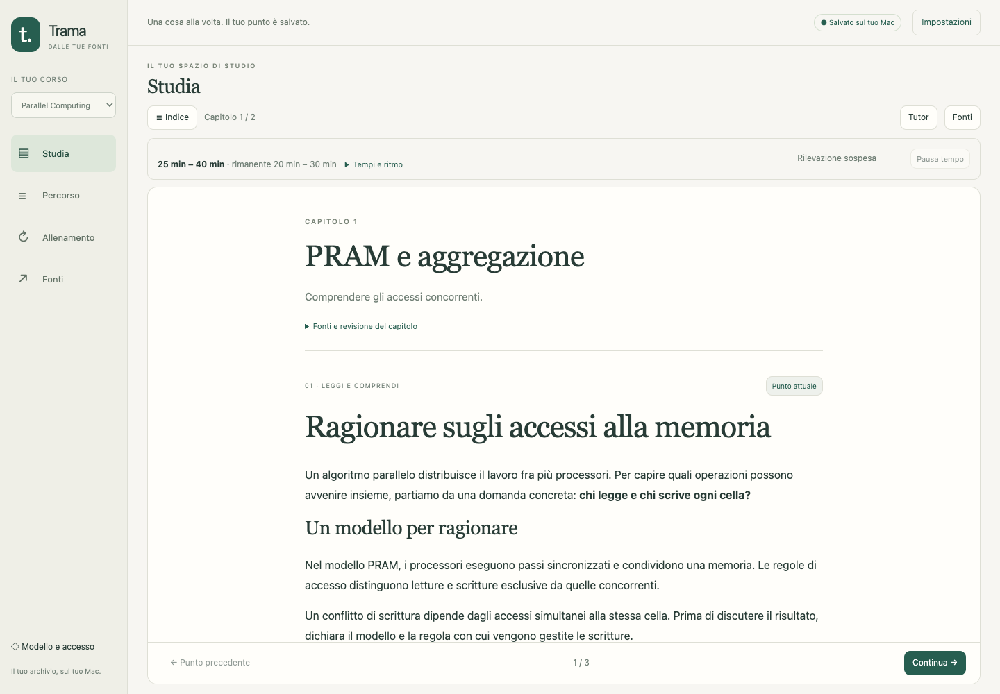
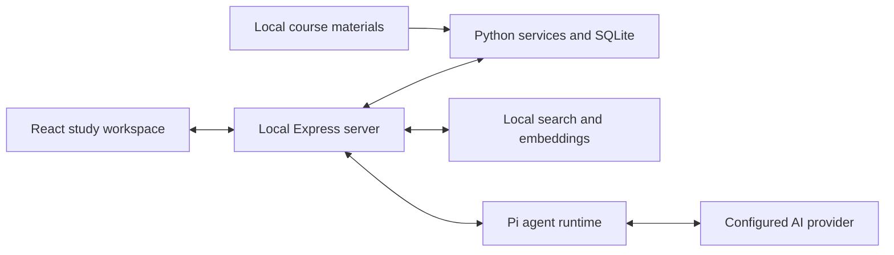

# Trama

**Study from your own sources. Understand, practice, and pick up where you left off.**

Trama is a local-first AI study companion that connects course materials to guided lessons, exercises, feedback, and a personal study path. It brings the chapter, tutor, original sources, and learning progress into one workspace.

The study workflow builds on the materials you provide. The included Polimi/WeBeep and Webex tools collect lectures and course files; the study engine can also work with materials organized locally for other courses.

**Current status:** experimental, macOS-first, with an Italian interface. The main README is in English; the detailed guides are currently in Italian.



*Screenshots use synthetic test data, not a personal course archive.*

<details>
<summary>Mobile workspace</summary>


</details>

[Get started](#get-started) · [Study workflow](#study-workflow) · [Data and model calls](#data-and-model-calls) · [Architecture](#architecture) · [Development](#development) · [Documentation](#documentation)

## What Trama does

| Area | Capabilities |
| --- | --- |
| Course preparation | Exam objectives, scope confirmation, prerequisites, chapter plans, examples, and independent practice. |
| Original sources | Search and browse PDFs, notebooks, transcripts, text, HTML, and source code, with page, cell, or timestamp references where available. |
| Study workspace | Chapter reader, course outline, optional tutor and source panels, light/dark themes, and layouts for desktop and mobile. |
| Beginner learning | Lesson-based topics progressing through prerequisites, explanations, worked examples, guided practice, independent practice, and recap. |
| Interactive activities | Multiple-choice, numeric, completion, open-ended, and sandboxed HTML activities with saved interaction state and text alternatives. |
| Math accessibility | LaTeX rendering and locally generated Italian reading descriptions, with whole-formula, symbol-navigation, and readable-text modes. |
| Exercises and feedback | Saved drafts, submitted answers, inline assessments, hints, corrections, and optional extended tutor explanations. |
| Learning continuity | Resume conversations and chapter positions; keep answers and assessments for identical exercises when starting a new tutor conversation. |
| Personalization | Evidence-linked study notes, correctable preferences, versioned explanations, and reversible course-plan changes. |
| Study-time estimates | Local estimates for chapters and the whole course, including planned chapters whose lessons have not been created yet. |
| Practice and recall | Scheduled FSRS recall, recorded use of hints, new practice variants, and reserved exam simulations. |
| Lecture archive | Incremental Polimi/WeBeep material collection and Webex downloads, local Whisper transcription, and slide/video alignment tools. |

### Preparation that can resume

Chapter writing uses an outline and small batches of complete blocks. Completed work is checkpointed before continuing. Repairs target individual blocks and reuse corrections already validated; later repairs receive updated dependencies as context.

Before publication, the preparation pipeline runs independent exercise solving, disciplinary review, and didactic review. Source-read receipts, structural validation, and checks for supported numerical models accompany the model reviews. Course references and external web references retain distinct provenance.

Interruptions preserve checkpoints. A valid result can be recovered without asking the model to generate it again. Unresolved content issues remain visible, and dependent material can be suspended rather than presented as verified.

These checks help catch mistakes; they do not establish that generated lessons are infallible.

### Feature details

#### Reading and talking to the tutor

- Keep a course outline pinned on desktop, or open it only when needed. Tutor, original sources, and conversation history share a resizable side panel; narrow screens use a full-screen panel.
- Select a passage and ask for an explanation or an example, with the quoted text included in the question.
- Return to the chapter without losing its position or the exercise draft. Available chapter revisions are offered explicitly instead of replacing the text while you read.
- Search previous conversations and resume them. The tutor can retrieve earlier sessions when you request it, with course boundaries and autonomous-practice restrictions.
- Cancel an active tutor response and retry an interrupted assessment or explanation while retaining saved attempts.

#### Learning from the basics

- A dedicated beginner path follows available lessons and their sources. Each topic has an objective, prerequisites, and a saved learning stage.
- Move through prerequisites, explanation, worked example, guided practice, independent practice, and recap at your request; change lesson or topic and return to its saved position.
- Where transcripts are missing, available OCR, alignments, and materials can support a lesson with explicit source-quality caveats. File order is not presented as a verified lecture chronology.
- Beginner-path next-day recall reminders are separate from FSRS scheduling and do not certify mastery merely because a day has passed.

#### Activities, assessments, and recall

- Exercises declare their assumptions and whether they are generated, adapted, or drawn from an original source. Answer keys and complete solutions remain server-side until submission or an explicit help request.
- Sandboxed HTML/CSS/JavaScript activities provide interactive models, observable actions, saved state, and text alternatives. Local interactions do not call the model on every change.
- Curated numeric, choice, and completion tasks can use mechanical checks. Generated exercises and open-ended assessments remain provisional, including when a model-generated numeric key matches.
- Hints and solution requests are recorded. You can contest an assessment, and the saved answer remains available alongside its feedback.
- Progress distinguishes attempted work, aided success, independent success, and later reconfirmation. Reconfirmation requires different problems and a time gap; scrolling or manipulating a simulator does not count as demonstrated understanding.
- Reserved exam simulations keep protected material out of ordinary training retrieval. Tutor chat is suspended during autonomous simulation, and explicit unlocking records that an exam is no longer unexposed.

#### Sources, search, and accessibility

- Hybrid retrieval combines SQLite full-text search with local multilingual embeddings. Import and embedding indexes update incrementally when indexed material changes.
- Browse the material library, search literal text or code, and read source ranges without executing notebooks or source files.
- Open locally rendered PDF pages, full PDFs, notebook text, or lecture video at the relevant timestamp. A capable configured model can inspect an original PDF page or video frame when extracted formulas, diagrams, or code are ambiguous.
- When course material is insufficient, the tutor can search the public web and read external HTML or PDF references. External provenance and differences in notation or assumptions remain distinct from course evidence.
- Math supports inline and display LaTeX. Speech Rule Engine generates Italian formula-reading descriptions locally, without AI requests; choose whole-formula reading, structural symbol navigation, or readable text. Native hover-reading behavior still depends on the browser and operating system.

#### Personalization and versioned study paths

- A study diary separates recorded evidence, provisional interpretations, stated preferences, and decisions. Open the linked attempt or message behind a note and correct the note without deleting its history.
- Preferences apply to the course unless explicitly extended to other courses. Model-written preference notes require evidence from the student's request.
- Evidence-linked plan revisions preserve existing chapters and prerequisites. Reverting a revision creates a new version rather than deleting earlier attempts or plans.
- Request a versioned explanation or open another chapter as a detour, then return to the saved study point.
- Changes to source material, preferences, or plans can invalidate dependent future content while preserving access to previously studied versions. Unresolved issues can be reopened with a clarification.

#### Provider controls and efficient requests

- Choose a provider/model from those available through the bundled Pi runtime, using the authentication modes it exposes. Availability depends on the account and provider.
- Optional OpenAI Luna/Sol routing assigns a reader and an expert to preparation work, verifies proposed exclusions, and escalates uncertain technical interpretation. The interface checks that the configured models are available before enabling it.
- Requests deduplicate repeated source text, avoid sending duplicate chapter content, and keep local checkpoint metadata out of model prompts.
- Tutor chat retrieves detailed plans and exam questions on demand while retaining the current chapter and study state. A saved assessment is reused; an extended explanation is generated only when requested.
- Checkpoints and bounded chapter repairs reduce repeated generation after interruptions. They do not eliminate provider charges or guarantee a fixed preparation cost.

#### Lecture acquisition and processing

- Guided Polimi/WeBeep course discovery supports separate course years, recording selection by date, trial downloads, and material collection. Manual collection remains available for portal structures the guided workflow does not recognize.
- Reuse the dedicated browser login, with manual password/MFA handling. Incremental downloads deduplicate recordings and verify positive duration plus audio/video streams; supported direct HTTP downloads can resume, while HLS downloads restart.
- Choose or download a local Whisper model and transcribe recordings in checkpointed chunks. Completed outputs are checked against the input and export hashes before being skipped.
- Associate video intervals with PDF pages or notebook candidates through the visual-analysis workflow. OCR and candidate matches retain their uncertainty; an association is not proof that a lecturer presented that exact source.
- Inspect archive status, run dependency diagnostics, import recording links, and manage data on an external drive through the existing launchers and CLI. See the detailed archive and alignment guides below.

## Get started

### Requirements

The supported launch workflow is designed for macOS. Other platforms have not been validated end to end.

- **Python 3.9+** for the launcher and archive tools.
- **A native Python 3.12 installation** available to create the managed visual-analysis runtime.
- **Node.js 22+**, including npm, for the local app and frontend build.
- **Tesseract OCR** for the visual runtime used by the study app.
- **FFmpeg and ffprobe** for the recording, audio, and transcription workflows.
- Internet access for initial dependency/model downloads and the configured AI provider.
- Access to an AI provider supported by the bundled Pi runtime for generated lessons and tutor responses.

If you use Homebrew, the external tools can be installed with:

```bash
brew install python@3.12 node tesseract ffmpeg
```

Setup installs the project environment and Chromium. Starting Trama prepares its managed Python runtime, Node dependencies, frontend, and local embedding environment in the configured data directory. Initial setup can take longer than subsequent launches.

### Install and launch

```bash
git clone https://github.com/iFralex/trama-study.git
cd trama-study
bash Setup.command
bash Studio.command
```

Setup asks for the email used by the Webex/Polimi connector and a data directory, which can be on an external drive. This setup step still reflects the project's lecture-archive origins. Passwords and MFA remain in the dedicated login browser.

Trama opens at **http://127.0.0.1:4326**. Keep the launcher terminal open while using the app; `Ctrl+C` stops it. The server binds to the local loopback address.

The launcher filename remains `Studio.command`, and the Python package remains `polimi_lectures`, to preserve existing commands and installations. The app itself is named Trama.

### Add course materials

Use `Avvia.command` for the guided Polimi/WeBeep collection workflow, or place your own course files in the configured data directory:

```text
<data-directory>/
  corsi/
    my-course-2026/
      materiali/
        lecture-slides.pdf
        notes.md
        examples.ipynb
```

The `materiali` directory identifies a locally available course. Use distinct course/year folders to keep materials and progress separate. Trama also recognizes transcripts and alignments produced by its lecture tools.

Open the app, choose the course, and connect an available model through **Modello e accesso** (“Model and access”). Provider authentication and model availability depend on your account. The repository does not contain your course materials or model credentials.

For the recording downloader, authentication, supported file layouts, transcription commands, and external-drive management, see the [lecture archive guide](docs/LECTURE_ARCHIVE_IT.md).

## Study workflow

1. **Define the goal.** State the exam or learning objective. Trama inspects the available materials and proposes a scope for confirmation.
2. **Prepare the path.** The app builds a course plan and prepares chapters progressively. Review progress, incomplete sources, and open issues in the preparation panel.
3. **Study the chapter.** Read explanations and examples, open the original sources, and use the tutor when needed.
4. **Submit an answer.** Your answer is saved first. The concise assessment appears below the exercise when it is ready. The extended explanation is generated when requested.
5. **Continue or revisit.** Keep your chapter position, reopen previous conversations, and return to scheduled recall or practice.

A new tutor conversation preserves work on the same exercise and chapter version. Changed exercises, separate paths, and autonomous exam/recall activities have their own boundaries. Starting a conversation does not create a duplicate assessment.

### Study time without extra model calls

Estimates are computed locally from visible content, formulas, code, activity types, explicit progress, and optional foreground study-time measurements.

Available chapters are estimated from their actual content. Future chapters use the existing plan and course structure, with wider ranges until their content exists. Estimates cover total and remaining work; scheduled recall has a separate budget.

You can set a daily study pace, mark sections as studied or needing review, and pause time tracking. Scrolling alone does not mark a section as learned. Estimates are approximate planning aids, not validated predictions of mastery or exam performance.

## Data and model calls

“Local-first” describes where the archive and application state live. AI features send the context needed for a request to your chosen provider.

| Operation or data | Where it lives or runs |
| --- | --- |
| Original recordings and materials | Configured local data directory; study tools treat originals as read-only. |
| Paths, chapters, attempts, assessments, review state | Local SQLite database in `.state/studio/studio.sqlite3` under the data directory. |
| Draft recovery and display preferences | Browser storage, alongside persisted study data where applicable. |
| Search embeddings and study-time estimates | Local processing; embedding models are downloaded initially. |
| Lesson generation, tutor chat, and model assessments | Configured AI provider, receiving relevant materials, answers, and context. |
| Additional web verification | Public web sources; provenance is recorded separately from course materials. |
| Provider credentials | Pi authentication mechanisms, separate from the learning database. |

The repository's ignore rules exclude course archives, `.state`, virtual environments, Node modules, and build outputs. Local browser sessions, diagnostic captures, and databases may contain private information and should remain outside Git.

Reserved exam material is excluded from training retrieval and tutor context under the app's simulation policies. This is an application workflow boundary, not a guarantee of model correctness or assessment validity.

## Architecture



- **Frontend:** React, TypeScript, assistant-ui, Markdown, and KaTeX, built with Vite.
- **Local server:** Express, the Pi agent runtime, study preparation orchestration, and FSRS scheduling.
- **Data services:** Python, SQLite/FTS5, source indexing, course state, preparation validation, and local study-time estimates.
- **Retrieval:** text search and multilingual local embeddings, with original-source references.
- **Lecture tools:** Playwright, HTTPX, FFmpeg, local Whisper, and an isolated visual-analysis runtime.

```text
polimi_lectures/       Python archive, retrieval, preparation, and study services
studio/src/           React application
studio/server/        Local API, agent runtime, and preparation orchestration
studio/tests/         TypeScript and Playwright tests
tests/                Python tests and isolated data fixtures
docs/                 Detailed usage, architecture, and verification guides
```

## Development

Run the launcher once to prepare the managed environments and the `studio/node_modules` link. Run Python study tests with the managed native runtime, which includes PDF and numerical dependencies:

```bash
# From the repository root; use your configured data-directory path.
TRAMA_DATA="/absolute/path/to/your/data"
PYTHONDONTWRITEBYTECODE=1 "$TRAMA_DATA/.state/slides-runtime/bin/python" \
  -m unittest discover -s tests -v

cd studio
npm test
npm run build
```

The automated agent tests use simulated local providers. They verify application behavior and SDK integration, not the educational quality of a commercial model.

Playwright tests require isolated fixture data and a separate test server, normally on port `4327`. `STUDIO_TEST_URL` and `STUDIO_CHROME` configure the server and browser. Some feature tests also require their documented fixture flags. See the [verification guide](docs/studio/VERIFICA.md) and fixture scripts in `tests/`. Do not run state-changing browser tests against a personal study archive.

Real-provider comparison and course-verification scripts are separate from the default tests and may send materials to the configured provider or incur usage charges.

## Current limits

- Generated lessons, open-ended assessments, and model reviews are provisional. Important claims should be checked against the original materials.
- The curated PRAM/reduction/prefix-sum path has more focused verification than arbitrary generated courses. Course plans for other subjects depend on their sources and the model.
- Transcripts, OCR, and slide/video associations can be incomplete or inaccurate. Source quality and unresolved discrepancies remain relevant.
- Local timing is an approximation; quiet reading, work away from the computer, and differences between subjects limit its precision.
- The current launch and acquisition workflows are macOS- and Polimi-oriented. The interface is currently Italian.
- Trama is designed for a local user. Remote hosting and multi-user deployment are not supported workflows.
- Native CUDA execution and handwritten input are not included.

## Documentation

Detailed guides are currently in Italian:

| Guide | Contents |
| --- | --- |
| [Study app](docs/studio/README.md) | Interface, model access, retrieval, formulas, themes, and persistence. |
| [Personal course](docs/studio/CORSO_PERSONALE.md) | Objectives, course plans, chapters, practice, and reserved exams. |
| [Learning from the basics](docs/studio/DALLE_BASI.md) | Lesson order, prerequisite-first learning stages, saved topics, and beginner recall reminders. |
| [Source-grounded preparation](docs/studio/PREPARAZIONE_VERIFICABILE.md) | Scope selection, reviews, source validation, checkpoints, and recovery. |
| [Study-time estimates](docs/studio/TEMPI_DI_STUDIO.md) | Local estimation, future chapters, progress, timing, and calibration. |
| [Architecture](docs/studio/ARCHITETTURA.md) | Application components and data flows. |
| [Verification](docs/studio/VERIFICA.md) | Technical checks and the limits of educational validation. |
| [Token audit](docs/studio/AUDIT_TOKEN.md) | Request costs and opportunities to reduce redundant context. |
| [Chat context](docs/studio/CONFRONTO_CONTESTO_CHAT.md) | Compact context, on-demand retrieval, and comparisons. |
| [Model and routing comparisons](docs/studio/CONFRONTO_MODELLI.md) | Evaluation methods, model comparisons, and the reader/expert preparation flow. |
| [Lecture archive](docs/LECTURE_ARCHIVE_IT.md) | Recording downloads, authentication, materials, transcription, and storage. |
| [Slide/video alignment](ALLINEAMENTO.md) | Visual-analysis setup, source matching, OCR, and resumable alignment. |

## Project background

Trama grew from a local lecture archive into a source-grounded study workspace. The original archive's implementation notes and references are preserved in the [archive guide](docs/LECTURE_ARCHIVE_IT.md#riferimenti-consultati).

For bug reports, describe the action, expected behavior, and actual result. Remove private course content, access URLs, cookies, and credentials before sharing logs or screenshots in [GitHub issues](https://github.com/iFralex/trama-study/issues).
